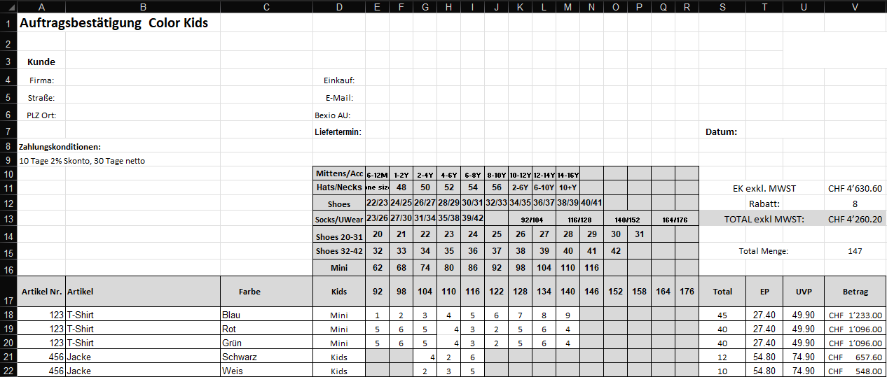

# Bexio Order Importer – User Manual

Welcome to the **Bexio Order Importer** user manual. This document provides a comprehensive guide on how to configure, run, and utilize the application to automate your Excel order processing and import data directly into the Bexio ERP system.

---

## Table of Contents

1. [Introduction](#1-introduction)
2. [Prerequisites & Installation](#2-prerequisites--installation)
3. [Configuration & Initial Setup](#3-configuration--initial-setup)
4. [Understanding the Excel Order Template](#4-understanding-the-excel-order-template)
5. [Step-by-Step Import Guide](#5-step-by-step-import-guide)
6. [Managing Profiles](#6-managing-profiles)
7. [Updating the Application](#7-updating-the-application)
8. [Troubleshooting & Support](#8-troubleshooting--support)

---

## 1. Introduction

The **Bexio Order Importer** is a tool designed to bridge the gap between traditional Excel-based order sheets (frequently used in wholesale, fashion, or retail distribution) and the Bexio REST API.

It parses complex spreadsheet files containing customer headers, order IDs, special discounts, and matrix-based size/quantity layouts, and automatically:

- Checks if the customer exists in Bexio (by email).
- Prompts you to confirm or create a new contact in Bexio.
- Generates a draft order with all mapped article positions.

---

## 2. Prerequisites & Installation

### System Requirements

- **Operating System**: Windows 10 or Windows 11 (64-bit).
- **Runtime**: .NET Runtime 10.0 (automatically managed or installed by the system).

### Installation via Installer

1. Download the latest `BexioOrderImportSetup.exe` from the **GitHub Releases** page.
2. Run the installer.
3. The installer operates as a low-privilege user install, meaning **no administrator rights (UAC prompt) are required**.
4. The application will install to your local user directory (`%LocalAppData%\Programs\BexioOrderImport`) and automatically create Start Menu and Desktop shortcuts.

---

## 3. Configuration & Initial Setup

When you first launch the application, you must configure the Bexio API connection and mapping parameters. Go to the **Settings** tab in the sidebar.

_(See section 4 below for mapping detailed coordinates matching the order sheet)_

### Bexio API Settings

1. **API-Token**: Paste your Bexio API Token here. To protect your credentials, this field automatically masks the token with dots (`••••••••`) when it loses focus. Clicking inside the field immediately shows the actual text for editing.
   - _How to get a token_: Log into your Bexio account under [https://developer.bexio.com](https://developer.bexio.com), navigate to **Personal Access Tokens** and create a new token.
2. **Revenue Account**: Only active bookkeeping accounts of type 1 are loaded dynamically from the Bexio API once the API connection is successful. The dropdown displays "AccountNo - Name" and uses the database **ID** as the selected identifier. This field remains disabled until connected. If options cannot be loaded, the field displays the last selected account ID.
3. **VAT Rate**: Only active VAT rates of type "sales_tax" or "not_taxable_turnover" are loaded dynamically from the Bexio API after a successful connection. Mapped using the database **ID** as the selected identifier. This field remains disabled until connected. If options cannot be loaded, the field displays the last selected tax ID.
4. **Payment Type**: The payment types are loaded from the Bexio API after a successful connection. The selected type is set on every order the import creates. The field is required: on first start nothing is selected and the import stays blocked until you choose a payment type. Settings saved by an older version keep payment type ID 1, which earlier versions always used. If options cannot be loaded, the field displays the last selected payment type ID.
5. **Season Code**: Enter an optional season prefix (e.g. `FS27`) used to prefix or filter article codes during Bexio article resolution.
6. **Position Text Template**: Define the template for the text written to Bexio order positions (default: `Color: {Color}, Size: {Size}`). Supported placeholders are `{Color}`, `{Size}`, `{ArticleNumber}`, `{ArticleName}`, `{BexioArticleName}`, and `{BexioArticleDescription}`. HTML formatting (e.g. `<strong>`, ` `) is fully supported by Bexio. You can configure this template within individual mapping profiles.

> [!NOTE]
> All configuration files are securely saved in your local user directory at `%LocalAppData%\BexioOrderImport\appsettings.json`. They remain fully preserved when the application updates itself to a newer version.

---

## 4. Understanding the Excel Order Template

Each profile uses one of two import formats:

- **Peakmile order form**: complex order forms with a size matrix, described below.
- **EAN list**: a simple list with EAN and quantity for one customer, see [EAN List Format](#ean-list-format).

The Peakmile importer is built to parse complex order forms that list article rows horizontally but expand size quantities vertically (as a matrix).

### Example Sheet Coordinates

Below is a typical order template layout showing how the parser reads the metadata and positions:

#### Mapped Excel Fields

- **Customer Header Metadata**:
  - **Customer / Company** [Cell `B4`]: Mapped customer company name.
  - **Street** [Cell `B5`]: Mapped customer street name.
  - **ZIP & City** [Cell `B6`]: Formatted as `[ZIP] [City]` (e.g., `7000 Chur`). The parser automatically splits this cell into separate postal code and city values.
  - **Email** [Cell `E5`]: Used to search for existing contacts in Bexio.
  - **Buyer Name** [Cell `E4`]: Mapped primary contact person.
  - **Order Number** [Cell `E6`]: Document number (`document_nr`) of an existing Bexio order (optional, e.g. `AU-00123`). If provided and valid, the importer searches for this order in Bexio and appends positions directly to it.
  - **Customer Number**: Contact number (`nr`) of an existing Bexio contact (optional, e.g. `10001`). If provided and valid, the importer searches for this contact by number and creates the order for them.
  - **Payment Terms** [Cell `A9`]: Plain text terms of payment.
  - **Discount %** [Cell `V12`]: The general discount rate applied to the whole order.
- **Size Matrix Mapping**:
  - **Start/End Row** [Rows `10` to `17`]: Coordinates defining where the size headers are declared.
  - **Category Column** [Column `4` / D]: Defines which category matches which size column.
  - **Start/End Size Column** [Columns `5` (E) to `18` (R)]: Tells the parser which range of columns holds size definitions (e.g., size `20`, `21`, `22`, etc.).
- **Data Row Mapping**:
  - **Start Row** [Row `18`]: Defines where the actual article lists begin.
  - **Article Number** [Column `1` / A]: Mapped product identifier (SKU).
  - **Article Name** [Column `2` / B]: Product description.
  - **Color** [Column `3` / C]: Product color.
  - **Category** [Column `4` / D]: Product category matching the matrix headers.
  - **UnitPrice (EP)** [Column `20` / T]: Individual wholesale price.

### EAN List Format

An EAN list has one article per row. Each customer has its own profile: the **customer number** (Bexio contact number `nr`) is set in the profile and is required. The columns and the first data row are set in the profile too; the defaults are:

| Column | Content | Notes |
|---|---|---|
| A | EAN | An EAN-13: 13 digits with a valid check digit. Excel drops the leading zeros of EANs stored as numbers, so shorter codes get them back: `826710896036` is read as `0826710896036`. An invalid EAN stops reading the file. |
| B | Quantity | Whole number. Rows with an empty quantity or a quantity of 0 or less are ignored. |

Row 1 is the header; data starts in row 2.

During the import:

1. The customer is searched by the customer number of the profile. There is no search by email and no new customer is created.
2. Every import creates a new order for that customer. Positions are never added to an existing order.
3. Each EAN must match the **internal code** (`intern_code`) of exactly one Bexio article. An EAN that matches no article or several articles stops the import.
4. Every row becomes its own position, also when an EAN appears several times. The price is the **sale price of the Bexio article**; prices in the Excel file are not read.
5. The position text comes from the **position text template** of the profile, by default `<strong>{BexioArticleName}</strong> {BexioArticleDescription} {EAN}`. Placeholders are `{EAN}`, `{BexioArticleName}` and `{BexioArticleDescription}`. Existing profiles keep their saved template.

The preview before the import shows the customer number, every position with its Excel row, the total quantity and the number of ignored rows. It warns if the customer number is missing. Article names and prices are only taken from Bexio during the import.

---

## 5. Step-by-Step Import Guide

### Step 1: Loading the Order Sheet

1. Navigate to the **Import** tab in the sidebar.
2. Select your Excel file (`.xlsx` or `.xlsm`; the old `.xls` format is not supported, save such files as `.xlsx` in Excel first) using one of two methods:
   - **Drag and Drop**: Drag the Excel sheet directly onto the dashed upload card.
   - **File Browser**: Click the upload card to open the Windows file explorer and select the file.
3. The application will display a rotating spinner while parsing.

### Step 2: Review Mapped Data & Preview

The preview depends on the format of the active profile. For Peakmile order forms:

1. The **Header Details** card displays the extracted customer metadata, Order Number / Customer Number (if provided), and payment conditions.
2. The **Positions preview grid** displays all parsed item rows. Only sizes with a quantity greater than zero will generate a row.
3. The totals below the grid show the quantity, gross amount, discount and net total.

### Step 3: Trigger the Import

1. Click **Import to Bexio** in the bottom right corner. A preview of the order data is shown.
2. **Confirm Upload**:
   - A confirmation dialog asks if you want to push the order to Bexio.
   - Click **Yes** to proceed.
3. **Existing Order Flow (if Order Number provided)**:
   - The application searches for the existing order by `document_nr` in Bexio. If the order is not found, the import is aborted with an error.
   - The contact email associated with the existing order in Bexio is matched against the email in the Excel sheet.
   - **If emails match**: It proceeds to add the positions directly to that order.
   - **If emails mismatch**: A warning dialog pops up, prompting the user to either ignore the mismatch and proceed with importing positions, or abort the import.
4. **New Order Flow (if no Order Number provided)**:
   - If a Customer Number is provided, the application searches for the contact by `nr` in Bexio. If not provided, it searches for a contact matching the customer's email.
   - **If found**: It proceeds automatically using that contact's internal ID.
   - **If NOT found**: A dialog pops up showing the new customer details. You can review, correct errors (e.g., misspelled street names), and click **Create** to insert them directly into Bexio. If you click **Cancel**, the import is aborted and the file remains loaded in your view.
   - A new order is created in Bexio under the matched/created contact.
5. Once the target order is resolved (either existing or newly created), the positions are uploaded, a full-screen loading card covers the interface, and a success dialog displays the Bexio order number.

---

## 6. Managing Profiles

The application supports multiple **Excel Mapping Profiles**. Each profile has an **import format** (eg. *Peakmile order form*) and stores the settings of that format, such as cell and column coordinates. Profiles are managed on the **Settings** tab; the profile list shows the format of each profile.

The **Import formats** card on the **Settings** tab lists all formats installed in the application.

### Create a new profile

1. In the **Settings** tab, click **Create Profile**.
2. Enter a unique name for the new profile and choose its format.
3. Configure the settings of the format for your Excel template.
4. Save – the new profile is now available in the profile list.

> [!NOTE]
> The format of a profile can't be changed later. To use another format, create a new profile.

### Clone a profile

1. Select the profile you want to use as a base.
2. Click **Clone**.
3. Enter a name for the cloned profile. The clone keeps the format of the original.
4. Adjust only the settings that differ from the original.

### Edit a profile

1. Select the profile from the list.
2. Click **Edit** to open the profile editor dialog. The format is shown but can't be changed.
3. Modify the desired values. Invalid numbers (eg. a row of 0) are reported when saving.
4. Confirm with **Save**, or **Cancel** to discard all changes.

### Set a profile as active

- Select the profile in the list and click **Set as active**.
- The active profile is highlighted and is used by the importer when loading Excel files.

### Profile Export / Import

- **Export**: Click **Export** to save all profiles to a portable JSON file. This is useful for backups or sharing configurations between machines.
- **Import**: Click **Import** and select a previously exported JSON file to load profiles into the application. Exports from older versions can still be imported.

> [!IMPORTANT]
> Each profile stores its import format. Versions 1.6.0 and older can't read settings or exports saved by a newer version. When the settings are saved for the first time after the update, the previous settings are copied once to `%LocalAppData%\BexioOrderImport\appsettings.v1.bak.json`.

> [!NOTE]
> The **Default** profile cannot be deleted. You can edit or clone it, but it will always remain available as a fallback.

---

## 7. Updating the Application

The application checks for updates automatically from its GitHub repository on every launch.

1. If a newer version is available, a colored **Update Banner** appears at the top of the interface:
   - _“An update to version v1.1.0 is available.”_
2. Click **Install Now**.
3. The app displays a progress bar while downloading the setup bundle to your temp folder.
4. The app will then run the installer silently in the background, close itself automatically to release file locks, update your installation, and restart. Your profile settings will remain untouched.

---

## 8. Troubleshooting & Support

### Common Issues

#### 1. Bexio Connection shows a Red Status Light

- **Check API Token**: Go to the **Settings** tab, click inside the token field to display it in plaintext, and verify that it matches your Bexio API Key exactly.
- **Firewall/Network**: Make sure your computer has an active internet connection and can reach `https://api.bexio.com`.

#### 2. The Excel Parsing Fails / throws a Coordinates Error

- **Verify Mapping**: Ensure the cell coordinates listed in your settings match your sheet exactly. Note that columns must be written as **numbers** (e.g., Column E is `5`, Column T is `20`) whereas individual header cells are written as standard **cell coordinates** (e.g., `B4`).
- **Sheet Index**: Ensure your Worksheet Index corresponds to the sheet containing the order (usually `1` for the first tab).

#### 3. Import fails / throws article-not-found error

- The importer queries your Bexio database for an article code matching the Excel `Art. No.` column.
- If the article number is not found in your Bexio product catalog, the importer aborts the import process to prevent incomplete imports. Make sure the article codes in the Excel sheet match your Bexio catalog exactly.

#### 4. EAN list import is cancelled or fails

- **"No customer number in the profile"**: The profile has no customer number. Open the profile and enter the Bexio contact number of the customer (profiles from earlier versions read it from the file and need it once).
- **"EAN … not found" / "not unique"**: The EAN must equal the internal code (`intern_code`) of exactly one article in Bexio, as a 13-digit EAN including leading zeros. Check the article in Bexio.
- **"Invalid quantity" / "Invalid EAN"**: The message names the Excel row. Quantities must be whole numbers, EANs valid EAN-13 codes (13 digits, or fewer if only leading zeros are missing, with a correct check digit).
